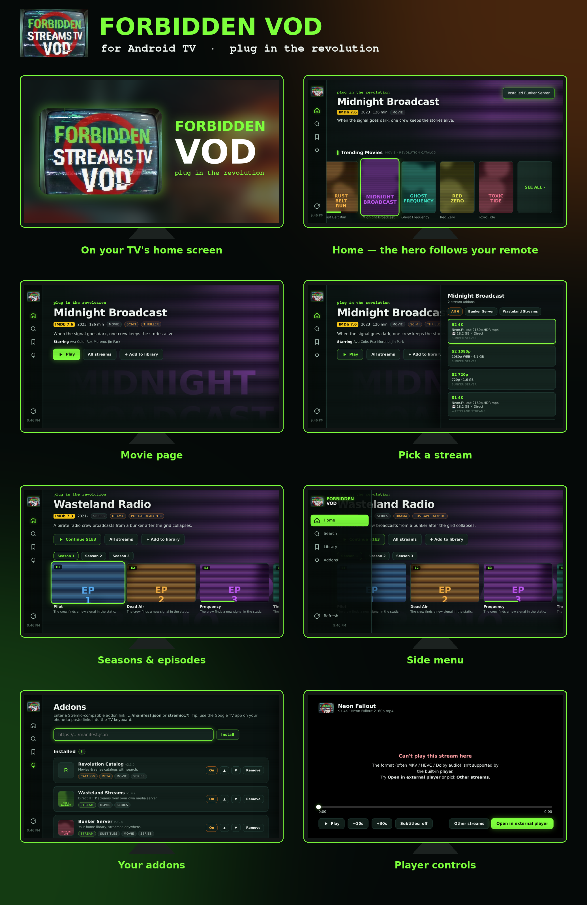

# Forbidden VOD — Android TV app

*plug in the revolution*

An Android TV / Google TV / Fire TV app that plays content from Stremio-compatible addons.
It works with the remote's arrows, OK, Back and play/pause buttons.

## Download the APK

Every change pushed to `main` is built automatically by GitHub Actions.
**Latest APK:** https://github.com/jaytatro/ForbiddenVOD/releases/latest/download/ForbiddenVOD.apk

## Build the APK yourself (optional, about 10 minutes the first time)

1. Install **Android Studio** (free): https://developer.android.com/studio
2. Unzip this folder, then in Android Studio choose **File → Open** and pick the `ForbiddenVOD` folder.
3. Wait for "Gradle sync" to finish (bottom status bar). The first time, it downloads what it needs.
   - If it asks to install a missing SDK platform or to "upgrade Android Gradle Plugin", click **Install / OK**.
4. Menu **Build → Build App Bundle(s) / APK(s) → Build APK(s)**.
5. When it finishes, click **locate** in the popup. Your file is
   `app/build/outputs/apk/debug/app-debug.apk`.

## Put it on your TV

Easiest way (no cables):
1. On the TV: **Settings → Device Preferences → About**, click **Build** 7 times to enable Developer options.
   Then in **Developer options** (or **Security & restrictions**) allow installing unknown apps.
2. Upload `app-debug.apk` somewhere you can reach with a link (Google Drive, Dropbox, your own site).
3. On the TV install the **Downloader** app (by AFTVnews) from the Play Store, enter the link, and install.

With a cable/ADB: `adb connect <TV-IP>` then `adb install app-debug.apk`.

Forbidden VOD then shows up in the TV's app row with its banner.

## Using it

- **Addons** (left menu): type or paste a `…/manifest.json` or `stremio://` link and choose Install.
  Typing on a TV is slow, so use the **Google TV app** on your phone as a keyboard and paste the link.
  You can paste several links at once, separated by spaces.
- **Player**: in Addons → Player, choose **External player** to send every stream to VLC / Just Player / MX Player
  (best for MKV, HEVC, Dolby audio). The built-in player handles MP4 and HLS.
- **Remote in the player**: ◀ ▶ = skip −10s / +30s · OK = pause · ▲ ▼ = show controls · Back = hide controls, then exit.

## Changing the look

The whole interface is one file: `app/src/main/assets/index.html`. Colors are at the top in `:root`
(`--toxic`, `--red`, `--fire`…). After editing, build the APK again.

Launcher banner: `app/src/main/res/drawable-xhdpi/banner.png` (320×180).
App icon: `app/src/main/res/mipmap-*/ic_launcher.png`.

## Signing key (so updates install over the old version)

GitHub Actions signs the APK with a permanent key stored in the repo's
**Settings → Secrets and variables → Actions**: `ANDROID_KEYSTORE_BASE64`, `ANDROID_KEYSTORE_PASSWORD`, `ANDROID_KEY_ALIAS`.
Keep a private backup of the `.jks` file and password — if they're lost, existing installs can't be updated.
Never commit the key to this repo.

## Before sharing the app with others

The release build is signed with Android Studio's debug key so it installs right away. To publish or
share widely, create your own key: **Build → Generate Signed App Bundle / APK** and follow the steps.

## Notes

- Torrent-only streams (no direct link) won't play; use addons that provide HTTP links.
- Watch history, library and addons are stored on the TV itself.

## Control panel (sell to customers)

Activation codes, expiry dates, TV limits, plan addons and TV messages — managed from your phone.
Panel: https://jaytatro.github.io/ForbiddenVOD/panel/ · setup guide: [panel/README.md](panel/README.md).
Until the panel is connected to a Supabase project, the app runs without activation.

## Phone version

`docs/phone-web-app.html` is a single-file phone version of the same app. Host it anywhere (GitHub Pages, Netlify) and use "Add to Home screen".
